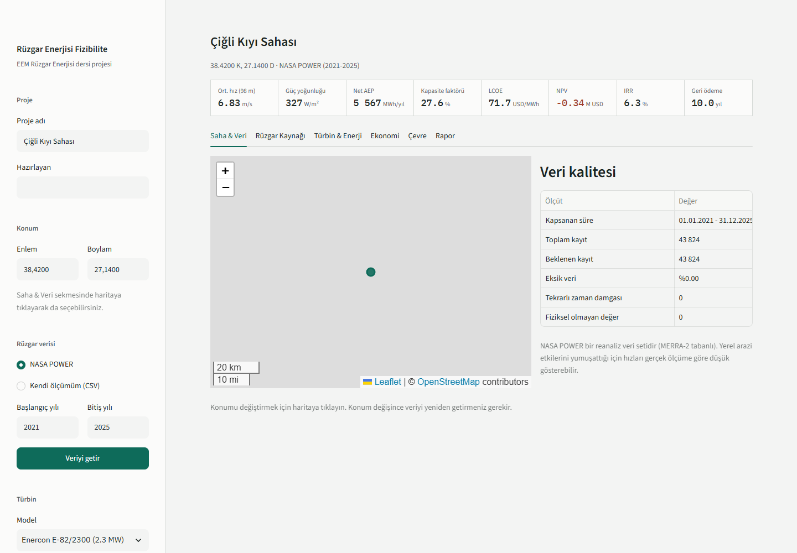
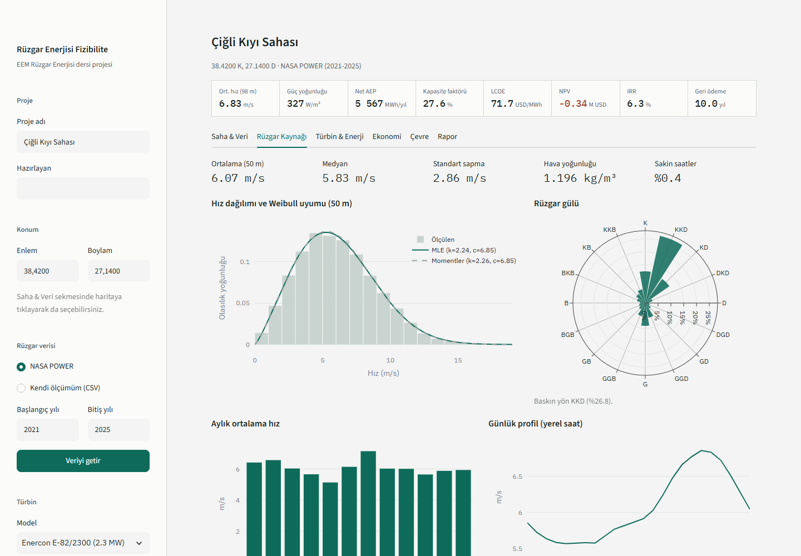
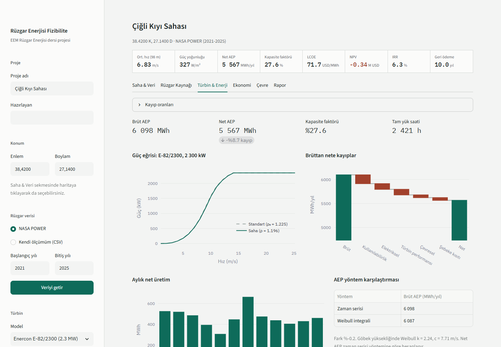
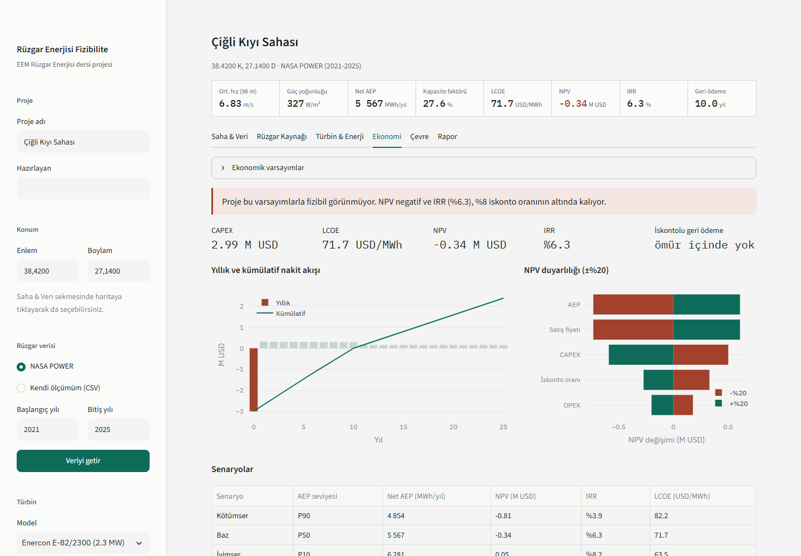

# Rüzgar Enerjisi Fizibilite Raporu Yazılımı

Seçilen bir konumda rüzgar santralinin (tek türbin veya küçük çiftlik) teknik ve ekonomik fizibilitesini hesaplayan ve Türkçe fizibilite raporu (Word/PDF) üreten Streamlit uygulaması. İzmir Bakırçay Üniversitesi, Elektrik-Elektronik Mühendisliği, Rüzgar Enerjisi dersi projesi.

Akış: konum seç → rüzgar verisini getir (NASA POWER) veya yükle (CSV) → türbin seç → ekonomik varsayımları gir → sonuçları incele → raporu indir.



## Kurulum (Windows, Python 3.11)

Sanal ortamı OneDrive dışında tutmak önerilir (senkronizasyon binlerce küçük dosyayla yavaşlar):

```bash
py -3.11 -m venv %USERPROFILE%\venvs\ruzgar-fizibilite
%USERPROFILE%\venvs\ruzgar-fizibilite\Scripts\activate
pip install -r requirements.txt
```

## Kullanım

```bash
streamlit run app/streamlit_app.py
```

1. Sol panelde proje adını ve konumu girin ya da **Saha & Veri** sekmesinde haritaya tıklayın.
2. **Veriyi getir** ile NASA POWER'dan saatlik veriyi çekin (ilk sorgu birkaç saniye sürer, sonra `data/cache/` altından okunur) ya da kendi ölçüm CSV'nizi yükleyin.
3. Türbin modelini, göbek yüksekliğini ve türbin adedini seçin. Ekstrapolasyon yöntemini (power law / log law) ve arazi tipini belirleyin.
4. **Türbin & Enerji** sekmesinde kayıp oranlarını, **Ekonomi** sekmesinde ekonomik varsayımları değiştirebilirsiniz. Üstteki sonuç şeridi anında güncellenir.
5. **Rapor** sekmesinde kapak bilgilerini doldurup **Raporu oluştur** ile Word ve (mümkünse) PDF raporu indirin.

`http://localhost:8501/?ornek=1` adresi örnek sahayı (İzmir) otomatik yükler.

Örnek raporu komut satırından üretmek için:

```bash
python scripts/ornek_rapor.py
```

Hazır örnek: [outputs/ornek_rapor.docx](outputs/ornek_rapor.docx) ve [outputs/ornek_rapor.pdf](outputs/ornek_rapor.pdf).

### CSV biçimi

Zaman ve hız sütunları zorunludur, yön, sıcaklık (°C) ve basınç (kPa) opsiyoneldir. Sütun adları otomatik eşleştirilir (`zaman/tarih/time`, `hız/ws/speed`, `yön/wd/dir`), `;` ayraç ve ondalık virgül desteklenir. Özel güç eğrisi CSV'si `wind_speed` (m/s) ve `power_kw` (kW) sütunlarını içermelidir.

## Ekran görüntüleri

| Rüzgar kaynağı | Türbin ve enerji | Ekonomi |
|---|---|---|
|  |  |  |

## Testler

```bash
pytest                 # birim, doğrulama ve uç durum testleri (ağ gerektirmez)
pytest -m network      # gerçek NASA POWER sorgusu (İzmir, 5 yıl)
```

`tests/test_validation.py` kapalı formda çözülebilen klasik ders kitabı problemlerini (Rayleigh rejimi, ideal türbin AEP'si, yükseklik ekstrapolasyonu, CRF ile LCOE, anüite NPV/IRR) elle hesaplanmış sonuçlarla karşılaştırır.

## Metodoloji

| Adım | Formül | Modül |
|---|---|---|
| Hava yoğunluğu | ρ = P / (R·T), R = 287.05 J/(kg·K), P [Pa] = PS [kPa]·1000 | `wind_resource.air_density` |
| Weibull (MLE) | `scipy.stats.weibull_min.fit(v, floc=0)`, v > 0 | `fit_weibull_mle` |
| Weibull (momentler) | k = (σ/v̄)^−1.086, c = v̄ / Γ(1 + 1/k) | `fit_weibull_moments` |
| Power law | v₂ = v₁·(h₂/h₁)^α, α = ln(v̄₅₀/v̄₁₀) / ln(50/10) | `power_law`, `site_alpha` |
| Log law | v₂ = v₁·ln(h₂/z₀) / ln(h₁/z₀) | `log_law` |
| Güç yoğunluğu | P/A = mean(½ρv³) ve Weibull: ½ρc³Γ(1 + 3/k) | `power_density_*` |
| Rüzgar sınıfı | NREL/PNL sınıf tablosu (10 m ve 50 m) | `wind_class` |
| Yoğunluk düzeltmesi | IEC 61400-12-1: v_saha = v_std·(ρ₀/ρ)^(1/3) | `energy.density_corrected_curve` |
| Brüt AEP | 8760·mean(P(vₜ)) ve 8760·∫P(v)f(v)dv | `aep_timeseries`, `aep_weibull` |
| Net AEP | Brüt·Π(1 − kᵢ) | `apply_losses` |
| LCOE | Σ(CAPEX + OPEX)/(1+r)ᵗ ÷ ΣE/(1+r)ᵗ | `economics.lcoe` |
| NPV, IRR | numpy-financial | `npv`, `irr` |
| Senaryolar | P90 = P50·(1 − 1.282σ), P10 = P50·(1 + 1.282σ) | `scenarios` |
| Önlenen CO₂ | Net AEP·EF | `environment.avoided_co2` |

Her fonksiyonun docstring'inde formül ve birimler yazılıdır.

## Varsayımlar

Tüm teknik ve ekonomik varsayımlar kaynak notlarıyla birlikte [config/defaults.yaml](config/defaults.yaml) dosyasındadır, kodda sabit değer yoktur. Önemli olanlar:

| Varsayım | Değer | Kaynak |
|---|---|---|
| CAPEX | 1 300 USD/kW | IRENA 2023 (küresel ort. ≈1 160 USD/kW, küçük proje için yukarı) |
| OPEX | 40 USD/kW/yıl, %2/yıl artış | IRENA 2023 |
| Satış fiyatı | 73 USD/MWh ilk 10 yıl, sonra 60 USD/MWh | Eski YEKDEM (örnek değer) |
| İskonto oranı, ömür | %8, 25 yıl | Varsayım |
| Kayıplar | iz %5 (çiftlik), kullanılabilirlik %3, elektrik %2, performans %2, çevresel %1, şebeke %1 | Tipik aralıklar |
| Emisyon faktörü | 0.438 tCO₂/MWh | ETKB 2022 |
| Hane tüketimi | 2 400 kWh/yıl | ~200 kWh/ay (kaynaklar tutarsız) |
| z₀ tablosu | Manwell, Tablo 2.2 | Kitapla kontrol edilmeli |

## Örnek saha sonuçları (İzmir, 38.42 K / 27.14 D)

NASA POWER 2021-2025, Enercon E-82/2300, 98 m göbek, tek türbin, varsayılan ekonomi:

| Gösterge | Değer |
|---|---|
| Ortalama hız 50 m / 98 m | 6.07 / 6.83 m/s |
| Weibull (50 m, MLE) | k = 2.24, c = 6.85 m/s |
| Güç yoğunluğu 50 m | 229 W/m² (NREL sınıf 2) |
| Net AEP, kapasite faktörü | 5 567 MWh/yıl, %27.6 |
| LCOE, NPV, IRR | 71.7 USD/MWh, −0.34 M USD, %6.3 |

### Global Wind Atlas karşılaştırması

| Yükseklik | NASA POWER (bu yazılım) | Global Wind Atlas |
|---|---|---|
| 10 m | 4.57 m/s | _doldurulacak_ |
| 50 m | 6.07 m/s | _doldurulacak_ |
| 100 m | 6.86 m/s (power law, α = 0.177) | _doldurulacak_ |

GWA değerleri yalnızca sitenin harita arayüzünden okunabiliyor (koordinatla sorgu yapılan açık bir API yok). Okumak için: [globalwindatlas.info](https://globalwindatlas.info) → arama kutusuna `38.42, 27.14` → haritada nokta işaretçisiyle konuma tıklayın → sağ panelde "Mean Wind Speed" değerlerini yükseklik bazında okuyun.

Farkın beklenen nedenleri:
- **Çözünürlük:** NASA POWER yaklaşık 0.5° × 0.625° (≈50 km) MERRA-2 hücresinin ortalamasını verir. GWA ise WAsP ile 250 m çözünürlüğe indirgenmiş, yerel orografi ve pürüzlülüğü hesaba katan bir modeldir. İzmir gibi kıyı ve dağ arası sahalarda bu fark belirgindir.
- **Kıyı etkisi:** Hücre kara ve denizi birlikte ortaladığı için deniz etkisi ve tepe hızlanması yumuşar.
- **Dönem:** GWA 3, 2008-2017 iklimini temsil eder (sitedeki güncel sürüm farklı bir dönem kullanabilir), bu çalışma 2021-2025 verisini kullanır.
- **Yükseklik profili:** 100 m değeri bu yazılımda 10 m ve 50 m'den türetilen α ile hesaplanır, GWA'da ise modelden gelir.

Genel olarak reanaliz verisi karmaşık arazide hızları olduğundan düşük gösterir. GWA değeri belirgin şekilde yüksekse ekonomi sekmesinde AEP duyarlılığı (+%10/+%20) ile sonucun nasıl değiştiğine bakılmalıdır.

## Sınırlamalar

- Rüzgar verisi reanalizdir. Yerinde ölçüm ve uzun dönem korelasyonu (MCP) yapılmaz.
- Hava yoğunluğu yüzey basıncı ve 2 m sıcaklıkla hesaplanır, göbek yüksekliğine düzeltilmez.
- İz kaybı yalnızca yüzde olarak modellenir, yerleşim ve iz modeli (Jensen vb.) yoktur.
- Türbulans, kesme histerezisi ve yüksek rüzgar davranışı güç eğrisinin dışında modellenmez (eğri dışında P = 0).
- Ekonomik model basittir: vergi zarar devri, KDV, işletme sermayesi ve kur riski yoktur. Kredili senaryoda özkaynak nakit akışı proje iskonto oranıyla iskontolanır.
- Senaryolar yalnızca AEP belirsizliğine dayanır (normal dağılım varsayımı).

## Klasör yapısı

```
app/streamlit_app.py      arayüz
core/                     hesaplama (Streamlit'ten bağımsız saf fonksiyonlar)
  data_sources.py         NASA POWER, CSV, temizleme
  wind_resource.py        istatistik, Weibull, ekstrapolasyon, yoğunluk
  energy.py               türbin, AEP, kayıplar
  economics.py            nakit akışı, LCOE, NPV, IRR, duyarlılık
  environment.py          CO₂ ve hane eşdeğeri
  analysis.py             uçtan uca analiz zinciri
  report.py               Word/PDF rapor
  plots.py                rapor grafikleri (matplotlib)
config/defaults.yaml      varsayımlar ve kaynakları
data/cache/               API önbelleği
data/turbines/            özel güç eğrisi CSV'leri
scripts/                  örnek rapor ve ekran görüntüsü betikleri
tests/                    pytest testleri
outputs/                  üretilen raporlar
prototip/                 ilk arayüz prototipi (statik HTML)
```

## PDF çıktısı

PDF dönüşümü önce `docx2pdf` (Microsoft Word gerekir), olmazsa LibreOffice (`soffice`) ile denenir. İkisi de yoksa rapor yalnızca .docx olarak üretilir. Word ile dönüşüm 20-30 saniye sürebilir.

## Kaynakça

- NASA POWER, https://power.larc.nasa.gov
- windpowerlib, https://github.com/wind-python/windpowerlib
- IEC 61400-12-1, rüzgar türbini güç performansı ölçümleri
- Manwell, McGowan, Rogers, *Wind Energy Explained*, 2. baskı, Wiley, 2009
- Elliott vd., *Wind Energy Resource Atlas of the United States*, NREL/PNL, 1986
- IRENA, *Renewable Power Generation Costs in 2023*
- ETKB, Elektrik Üretim ve Tüketim Noktası Emisyon Faktörleri, 2022
- Global Wind Atlas 3, DTU / Dünya Bankası, https://globalwindatlas.info
